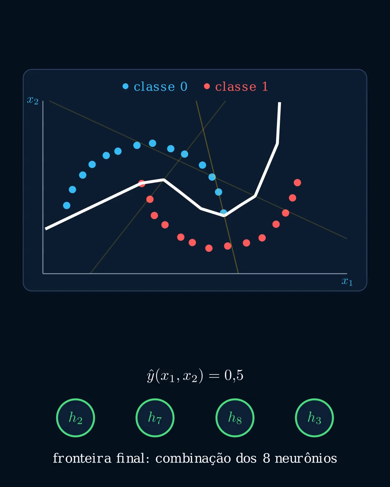
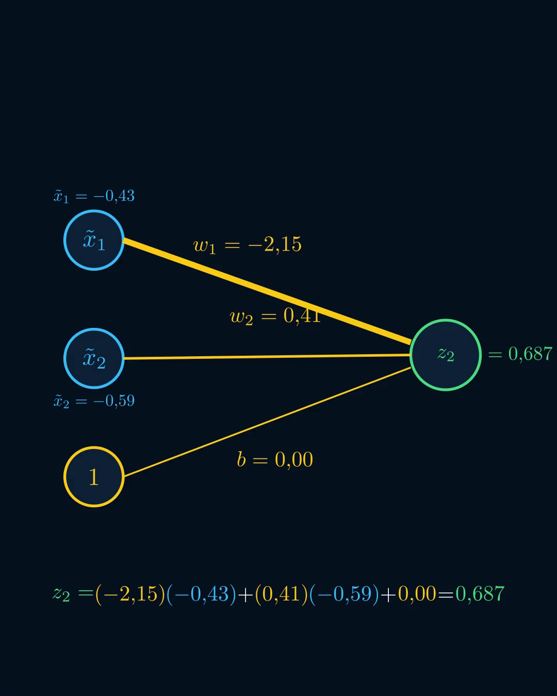
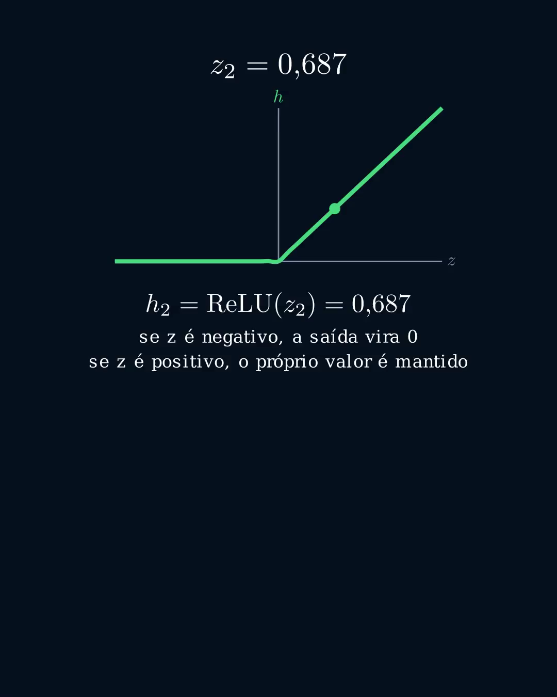
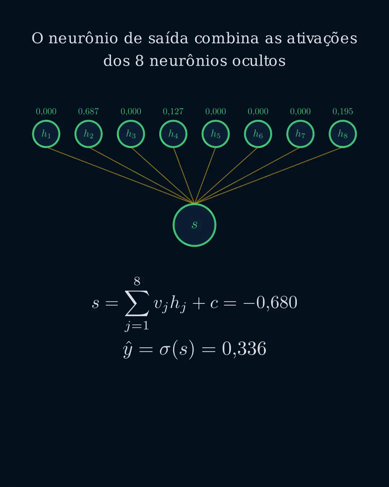
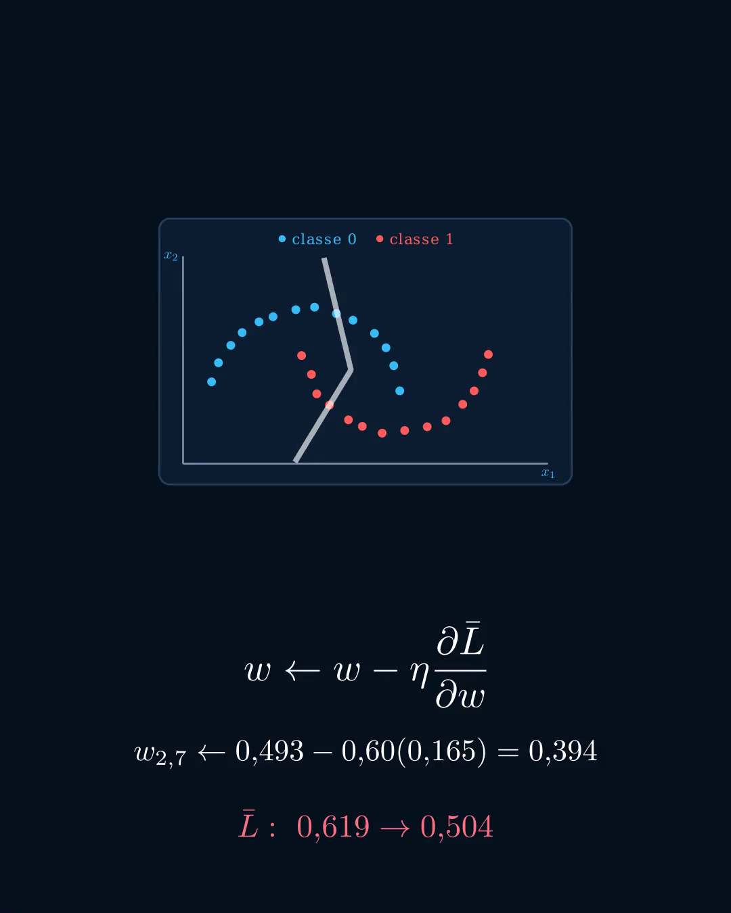

# Treinamento Numérico de uma Rede Neural com NumPy e Manim

Visualização técnica e reprodutível do treinamento de uma rede neural 2–8–1. Os dados, pesos, ativações, previsões, gradientes, perdas e fronteiras de decisão exibidos na animação são produzidos pelo mesmo treinamento determinístico implementado em NumPy.

## Vídeo final

Clique na imagem para abrir o arquivo [neural-network-learning-1080x1350-2x.mp4](assets/videos/neural-network-learning-1080x1350-2x.mp4).

| Propriedade | Valor |
| --- | ---: |
| Resolução | 1080 × 1350 |
| Taxa de quadros | 60 FPS |
| Quadros | 8.854 |
| Duração | 147,567 s |
| Codificação | H.264, YUV 4:2:0 |
| Tamanho aproximado | 9,3 MB |

O vídeo não contém faixa de áudio. A versão publicada duplica cada quadro da renderização-base para preservar integralmente a composição e aumentar o tempo disponível para narração.

## Escopo

O projeto mostra, em sequência:

1. geração de duas classes sintéticas em formato de meias-luas;
2. normalização das duas variáveis de entrada;
3. combinação afim em um neurônio oculto;
4. aplicação da função ReLU;
5. combinação das oito ativações ocultas;
6. saída sigmoide e interpretação probabilística;
7. entropia cruzada binária;
8. retropropagação e atualização de um peso;
9. evolução da fronteira e da perda nas épocas 0, 1, 10, 50 e 100.

O [notebook técnico](notebooks/neural_network_training.ipynb) intercala a formulação matemática com células executáveis baseadas no módulo real de treinamento.

## Modelo numérico

### Dados

O conjunto contém 28 observações, 14 por classe. As coordenadas são geradas com semente fixa e normalizadas por

$$
\tilde{\mathbf{x}} =
\frac{\mathbf{x}-\boldsymbol{\mu}}{\boldsymbol{\sigma}}.
$$

Uma busca angular densa encontra acurácia linear máxima de 0,892857. Portanto, nenhuma única reta classifica corretamente todos os pontos desse conjunto.

### Arquitetura

| Componente | Configuração |
| --- | --- |
| Entrada | 2 variáveis normalizadas |
| Camada oculta | 8 neurônios |
| Ativação oculta | ReLU |
| Saída | 1 neurônio sigmoide |
| Função de perda | Entropia cruzada binária média |
| Otimizador | Gradiente descendente em lote completo |
| Taxa de aprendizado | 0,60 |
| Épocas | 100 |
| Semente | 13 |

O passe direto é definido por

$$
\mathbf{z}^{(1)} =
\tilde{\mathbf{X}}\mathbf{W}^{(1)}+\mathbf{b}^{(1)},
\qquad
\mathbf{h}=\max(0,\mathbf{z}^{(1)}),
$$

$$
s=\mathbf{h}\mathbf{W}^{(2)}+b^{(2)},
\qquad
\hat{\mathbf{y}}=\sigma(s).
$$

A perda média é

$$
\bar L =
-\frac{1}{n}\sum_{i=1}^{n}
\left[
y_i\ln(\hat y_i)+(1-y_i)\ln(1-\hat y_i)
\right].
$$

## Substituição numérica exibida

Para a observação selecionada, a animação substitui os símbolos pelos valores do snapshot inicial:

$$
z_2=(-2{,}15)(-0{,}43)+(0{,}41)(-0{,}59)+0{,}00=0{,}687.
$$

Como

$$
\operatorname{ReLU}(z)=\max(0,z),
$$

o resultado positivo é preservado:

$$
h_2=\operatorname{ReLU}(z_2)=0{,}687.
$$

## Combinação das ativações

As oito ativações são combinadas pelo neurônio de saída. No exemplo inicial,

$$
s=\sum_{j=1}^{8}v_jh_j+c=-0{,}680,
\qquad
\hat y=\sigma(s)=0{,}336.
$$

A resposta correta da observação é 1, produzindo BCE individual igual a 1,089757.

## Retropropagação

A atualização segue

$$
w\leftarrow w-\eta\frac{\partial\bar L}{\partial w}.
$$

O peso destacado é atualizado com valores calculados pelo treinamento:

$$
w_{2,7}\leftarrow
0{,}493-0{,}60(0{,}165)=0{,}394.
$$

Os gradientes analíticos de $\mathbf{W}^{(1)}$, $\mathbf{b}^{(1)}$, $\mathbf{W}^{(2)}$ e $b^{(2)}$ foram comparados com diferenças finitas centrais. O maior erro relativo observado foi $1{,}533\times10^{-9}$.

## Resultados do treinamento

| Época | Perda média | Acurácia de treinamento |
| ---: | ---: | ---: |
| 0 | 0,618574 | 67,86% |
| 1 | 0,504326 | 71,43% |
| 10 | 0,279547 | 85,71% |
| 50 | 0,154641 | 92,86% |
| 100 | 0,083853 | 100,00% |

A acurácia final descreve somente os 28 pontos de treinamento. Não constitui estimativa de generalização.

## Estrutura do repositório

~~~text
.
├── assets/
│   ├── images/                         # quadros representativos
│   └── videos/                         # MP4 final
├── notebooks/
│   └── neural_network_training.ipynb   # análise executável
├── neural_training_numpy.py            # dados, treinamento e inferência
├── neural_network_learning_numpy.py    # cena Manim
├── validate_neural_training.py         # testes numéricos e gradientes
├── validate_neural_video.py            # metadados e extração de quadros
├── validate_public_release.py          # auditoria documental
├── render_neural_network_numpy.ps1     # renderização no Windows
└── slow_video_2x.py                    # duplicação determinística de quadros
~~~

## Ambiente

O ambiente validado utiliza:

- Python 3.13;
- Manim Community 0.21.0;
- NumPy 2.5.2;
- PyAV 18.1.0;
- Pillow 12.3.0;
- uma distribuição LaTeX com <code>latex</code> e <code>dvisvgm</code> disponíveis no PATH.

O Manim também requer FFmpeg e as dependências de sistema descritas na [documentação de instalação](https://docs.manim.community/en/stable/installation.html).

### Instalação

~~~bash
python -m venv .venv
~~~

Windows:

~~~powershell
.\.venv\Scripts\python.exe -m pip install --upgrade pip
.\.venv\Scripts\python.exe -m pip install -r requirements.txt
~~~

Linux ou macOS:

~~~bash
./.venv/bin/python -m pip install --upgrade pip
./.venv/bin/python -m pip install -r requirements.txt
~~~

## Validação

Validação numérica:

~~~powershell
.\.venv\Scripts\python.exe validate_neural_training.py
~~~

Validação dos arquivos públicos e execução sequencial das células do notebook:

~~~powershell
.\.venv\Scripts\python.exe validate_public_release.py --execute-notebook
~~~

Resultado esperado:

~~~text
validation=OK
public_release_validation=OK
~~~

## Renderização

No Windows, após instalar LaTeX:

~~~powershell
.\render_neural_network_numpy.ps1
~~~

Comando equivalente:

~~~powershell
.\.venv\Scripts\python.exe -m manim -r 1080,1350 --fps 60 neural_network_learning_numpy.py NeuralNetworkLearningNumpy -o ComoUmaRedeNeuralAprende_NumPy_corrigido_1080x1350.mp4
~~~

Para gerar a versão com duração duplicada:

~~~powershell
.\.venv\Scripts\python.exe slow_video_2x.py media\videos\neural_network_learning_numpy\1350p60\ComoUmaRedeNeuralAprende_NumPy_corrigido_1080x1350.mp4 neural-network-learning-1080x1350-2x.mp4 --factor 2
~~~

O script duplica os quadros e mantém a taxa de 60 FPS. Não são inseridas novas cenas nem interpolações.

## Notebook

O notebook pode ser lido diretamente no GitHub ou executado em um ambiente Jupyter:

~~~bash
python -m pip install jupyterlab
jupyter lab notebooks/neural_network_training.ipynb
~~~

As referências a imagens e ao vídeo são relativas ao repositório, preservando a visualização local e no GitHub.

## Limitações

- O conjunto de dados é sintético e pequeno.
- A arquitetura foi escolhida para demonstração visual, não por busca de hiperparâmetros.
- O treinamento usa derivadas implementadas manualmente, sem diferenciação automática.
- A acurácia reportada é de treinamento; não há conjunto de validação ou teste.
- A fronteira parcial de poucos neurônios representa a soma real desses termos com o viés de saída, mas não equivale a um modelo treinado separadamente.
- A duplicação temporal reduz a velocidade de reprodução sem aumentar a informação visual.

## Dependências e licença

As atribuições das bibliotecas e da referência de estudo estão registradas em [THIRD_PARTY_NOTICES.md](THIRD_PARTY_NOTICES.md).

O código e a mídia original deste repositório são distribuídos sob a [Licença MIT](LICENSE).
